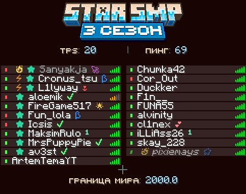

# 💬 Чат
## Виды чата
- **Локальный чат**: сообщение, отправленное в локальный чат, помечается серой | перед ником игрока, отправившего сообщение. Локальный чат действует в радиусе **35 блоков**.

- **Глобальный чат**: сообщение, отправленное в глобальный чат, помечается жёлтой | перед ником игрока, отправившего сообщение. Распространяется на все миры. Поставьте перед сообщением `!`, чтобы отправить его в глобальный чат.

- **Дискорд чат**: сообщение, отправленное в дискорд канале `#игра`, помечается синей | перед ником игрока, отправившего сообщение. Отображается всем игрокам.
## Теги
| Тег          |           Описание            |
| ---------------- | :----------------------: |
| `[pos]` | выводит в чат ваши координаты |
| `[item]` | отображает в чате ваш предмет в ведущей руке |
| `[inv]` | выводит в чат содержимое вашего инвентаря |
| `[ender]` | выводит в чат содержимое вашего эндер-сундука |
| `[ping]` | выводит в чат информацию о вашем пинге |
| `[/команда]` | отправляет в чат **кликабельную** команду |
## Личные сообщения
Вы можете делиться своей секретной информацией между определенными игроками с помощью команды `/msg <ник> <сообщение>`.

У нее также есть другие варианты написания: `/w`, `/pm`, `/m`.

Ответить на личное сообщение можно командой `/reply <ответ>` или `/r`.
## РП команды
На нашем сервере также есть несколько команд, которые помогут вам в отыгровке РП-сценария.
| Команда          |           Описание            |
| ---------------- | :----------------------: |
| `/do`        | выводит в чат и над головой текст с вашим действием |
| `/try`        |       выводит в чат и над головой текст с вашим заявлением от третьего лица        |
| `/dice` |   выводит в чат результат при броске игрального кубика    |
| `/try` |   выводит в чат результат при попытке выполнения действия    |

{width="800" height="600" style="display: block; margin: 0 auto" }

# 📑 Таб
## Список игроков
Таблист нашего сервера разнообразный, поэтому, для многих, нужно объяснение некоторых вещей.

### Технические показатели
`TPS` своего рода лагометр, показывает сколько тиков в секунду выполняется на сервере. Если значение 20 или близко к нему (от 19), то сервер не лагает.

`ПИНГ` отображает скорость вашего интернет-соединения.
### Показатели игроков
`▮` меняет свой цвет в зависимости от измерения игрока:
- ▮ зелёный, когда игрок в Верхнем мире;
- ▮ красный, когда игрок в Нижнем мире;
- ▮ розовый, когда игрок в Энде.

Далее идут статусы (роли) игрока, к ним относятся Совет, StarPlus, Модерация, Администрация и т.д.

`Серый` цвет ника означает, что игрок в **AFK**.

После ника игрока идут его теги, которые можно поставить командой `/tags`.
### Статистика
Нижняя строка меняется каждые **6 секунд**, она показывает:
- онлайн сервера;
- ваше наигранное время;
- границу мира, в котором вы находитесь.