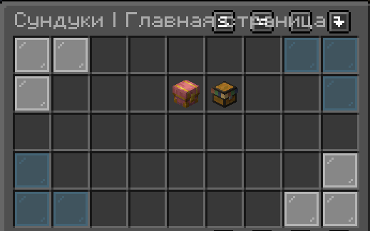

# 💅🏻 Косметика
На нашем сервере реализована система косметики. За старкоины вы можете покупать ключи от сундуков с косметикой, либо покупать её напрямую.
## Система сундуков
Самый простой способ получения косметики - открытие сундуков. Это что-то по типу кейсов/лутбоксов. На момент 3 сезона(01.08.2025) существует всего 2 сундука: Первый и летний. В зависимости от даты добавления сундука цена на него будет увеличиваться с каждым новым сезоном.

### Содержимое сундуков
Сундуки содержат в себе разную косметику: эффекты рыбалки, стрел, удара мечом и вокруг игрока. В будущем мы будем добавлять больше типов эффектов.

## Эффекты
Система эффектов содержит в себе 4 вида различных эффектов:
- Эффекты вокруг игрока
- Эффекты стрел
- Эффекты ударов мечом
- Эффекты рыбалки

Для настройки эффектов сделано удобное меню с переключением между типами эффектов `/particles`.

## Теги
Теги - это еще один способ выделиться среди игроков. Отображаются они в табе и над головой игрока. В описании тега указан способ его получения и как он будет выглядеть рядом с вашим ником. Попасть в меню тегов можно с помощью команды `/tags`.

Теги более редкие, чем вся остальная косметика: они выдаются в основном за различные события на сервере (ивенты) и заслуги игроков, но некоторые из них иногда продаются в магазине либо вылавливаются с рыбалки.
### Меню тегов

### Вид в игре
