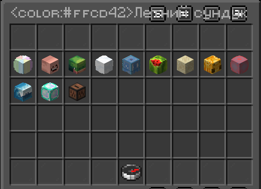
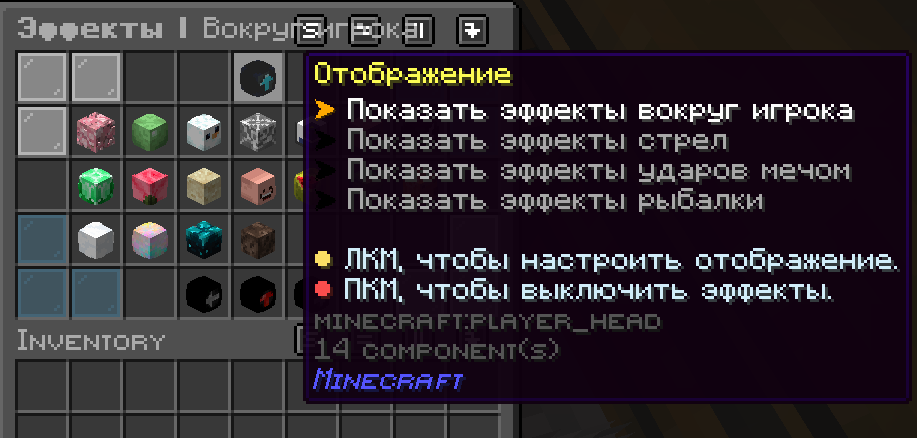
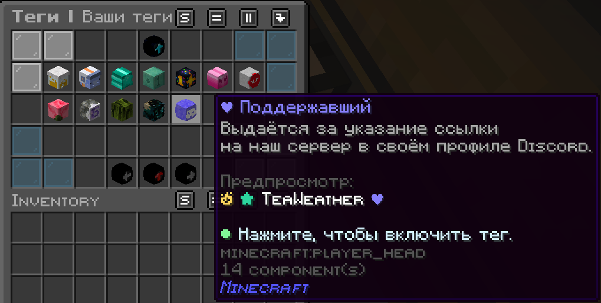
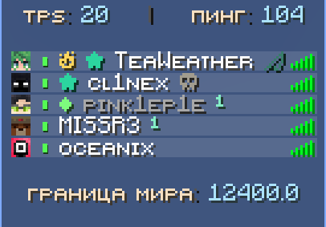

# 💅🏻 Косметика
На нашем сервере реализована система косметики. За старкоины вы можете покупать ключи от кейсов с косметикой, либо покупать её напрямую.
## Система кейсов
Самый простой способ получания косметики - открытие кейсов. На момент 3 сезона(01.08.2025) существует всего 2 кейса: Первый и летний.

### Содержимое кейсов
Кейсы содержат в себе разную косметику: Эффекты рыбалки, удара мечом, эффекты вокруг игрока и т.д.

## Эффекты
Система эффектов содержит в себе 4 вида различных эффектов:
- Эффекты вокруг игрока
- Эффекты стрел
- Эффекты ударов мечом
- Эффекты рыбалки

Для настройки эффектов сделано удобное меню с переключением между типами эффектов.

## Теги
Теги - это еще один способ выделиться среди игроков. Отображаются они в табе и над головой игрока. В описании тега указан способ его получения и как он будет выглядеть рядом с вашим ником. Попасть в меню тегов можно с помощью команды `/tags`.
### Меню тегов

### Вид в игре
