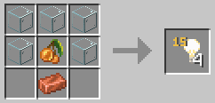
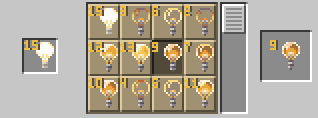

# 💡 Невидимый свет
На сервере у вас есть возможность осветить свою территорию, не прибегая к использованию факелов, фонарей и других источников освещения, что помогает улучшить визуал вашей постройки или территории!

Невидимый свет — это блок, который излучает свет на уровне факела, но не имеет визуала, что очень помогает в интерьерах и постройках.

## Крафт блока невидимого света <Badge type="warning" text="новое" />

Уровень света можно поменять с помощью камнереза.

