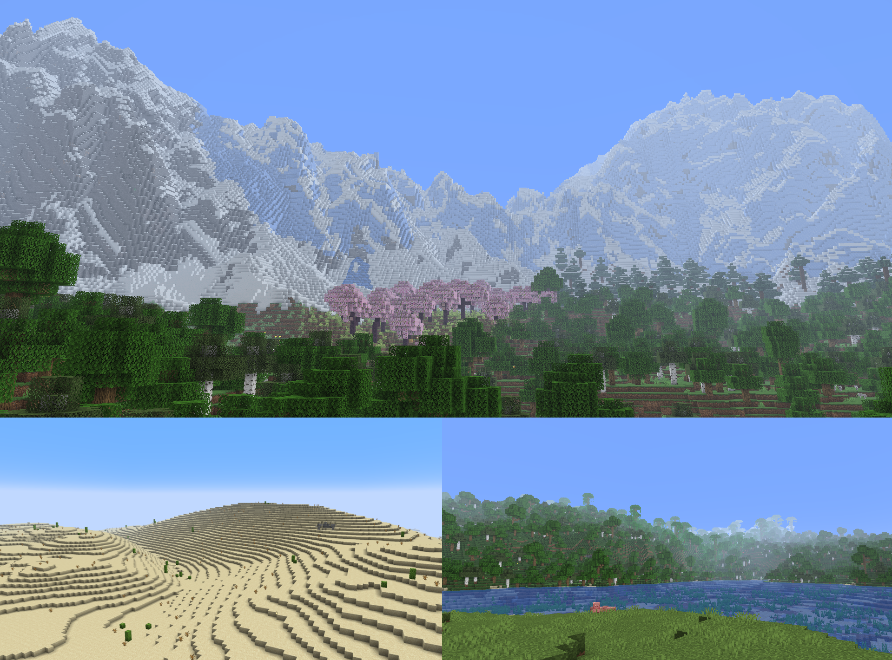

# 🌏 Генерация мира <Badge type="warning" text="новое" />
## Верхний мир
На сервер установлен датапак, который изменяет форму генерации ландшафта, делая мир более разнообразным и интересным для исследования. Высота верхнего мира увеличена **до 640 блоков**, что позволяет увидеть ещё более впечатляющие горные хребты и глубокие каньоны. Пустыни теперь выглядят как дюны, а ровные поверхности стали еще более сглаженными, что делает мир более уникальным и разнообразным. Океаны стали глубже, добавляя возможность для создания подводных приключений.

