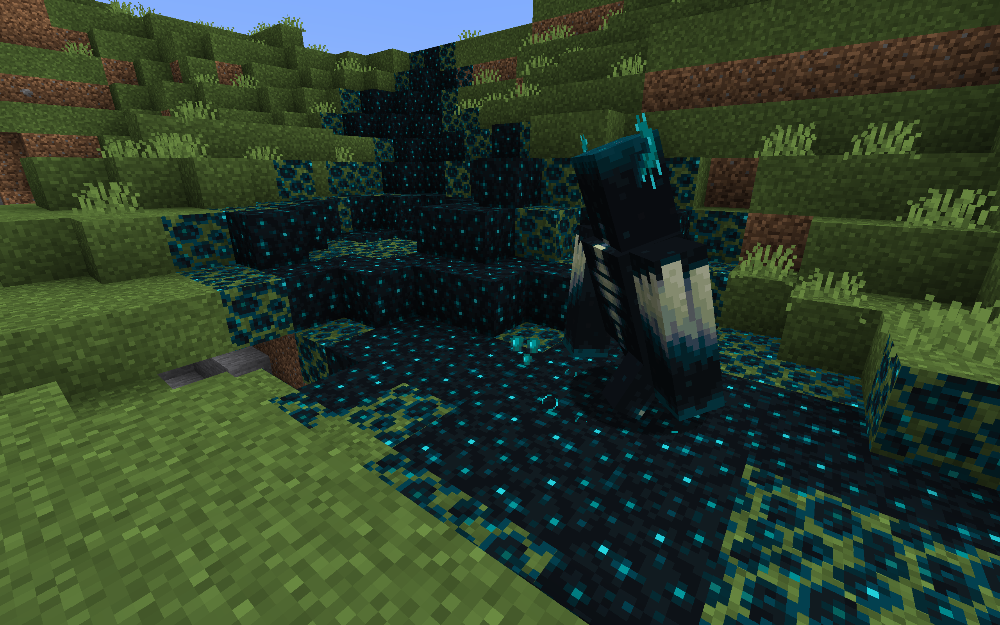

::: danger Эту статью предлагается удалить
В связи с отключением функции "Дополнения к скалку" страница будет удалена в ближайшее время.
:::
# 👽 Дополнения к скалку <Badge type="warning" text="новое" /> <Badge type="danger" text="отключено" />
## Хранитель 
Хранитель теперь распространяет небольшое количество скалка по земле, куда бы он ни шел. Иногда это могут быть скалк-сенсоры и даже скалковые крикуны. Если вы пытаетесь сдержать Хранителя или вывести его на поверхность, будьте осторожны! 

Кроме того, Хранители теперь быстрее плавают в воде и не могут утонуть.

## Возвратный компас
У возвратного компаса есть еще одно применение: каждые 2 секунды он испускает частицы души, которые указывают в направлении ближайшего моба или игрока в пределах 32 блоков от вас.

## Игровой процесс
- По скалковым жилам теперь можно лазить, что делает навигацию по древним городам еще более интересной. 
- Блоки скалка, скалковые катализаторы и усиленный глубокий сланец теперь вечно горят огнём души при поджоге.

## Рецепты
- Вы можете сделать из четырёх скалковых жил скалковый блок и наоборот.
- Вы можете переплавить один блок скалка в одну скалковую жилу и получить немного опыта, что дает возможность автоматически извлекать опыт из скалка, а не разбивать его вручную или мотыгой. 
- Вы можете превратить восемь блоков скалка и одну стеклянную бутылку в бутылку опыта, предоставляя возможность накапливать их, не требуя торговли с жителями.