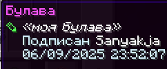

# ✏ Подписание предмета <Badge type="warning" text="новое" />
## Как подписать предмет
Чтобы избежать непонятных ситуаций, мы добавили возможность подписывать предметы. В описании предмета появится ваш ник, дата подписи и (по желанию) написанный вами текст.

Как только вы подписываете предмет, на него накладывается блок, который не дает удалить/изменить подпись другому игроку. Этот блок можно снять.
| Команда          |           Описание            |
| ---------------- | :----------------------: |
| `/sign [текст]` | добавляет подпись к предмету [текст по желанию] |
| `/sign delete` | убирает подпись с вашего предмета |
| `/sign unlock` | снимает блок с подписи предмета |

