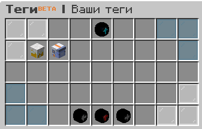
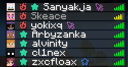

# 🏷️ Теги
Теги (/tags) - особые значки после ника, отображающиеся в табе и над головой игрока. В описании тега указан способ его получения и как он будет выглядеть рядом с вашим ником.
## Меню тегов

## Вид тегов в табе
