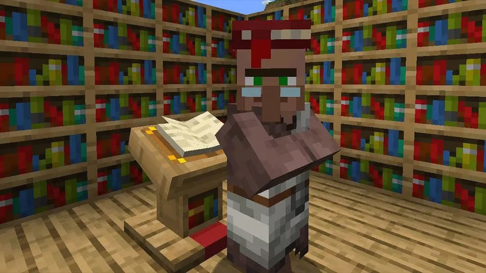

# ⚖ Ребаланс торговли от Mojang <Badge type="warning" text="новое" />
По словам сотрудников Mojang, сделки библиотекаря слишком дисбалансны на фоне стола зачаровывания и самостоятельного поиска зачарованных книг. Изменение механики вынудит игроков исследовать деревни в разных биомах и разблокировать уровни жителей для того, чтобы получить нужную книгу, а не полагаться на случайность, как это было раньше. Изменения также коснулись странствующего торговца: ранее он продавал малополезные предметы по завышенным ценам. С новыми изменениями цены его предложений снижены, добавлены новые сделки и возможность продавать ему предметы.

Более подробно можно ознакомиться [здесь](https://ru.minecraft.wiki/w/Балансировка_торговли).

::: tip Примечание
В связи с обновлением жителей мы также убрали из наковальни `Too expensive! (Слишком дорого!)`.
:::

