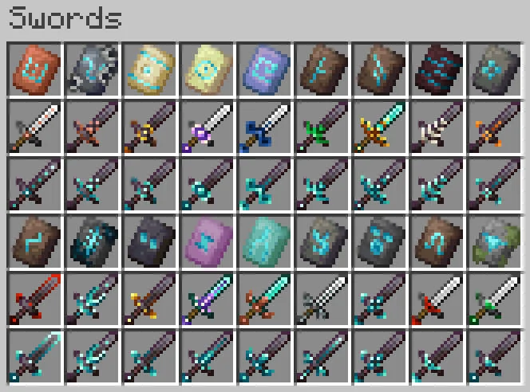
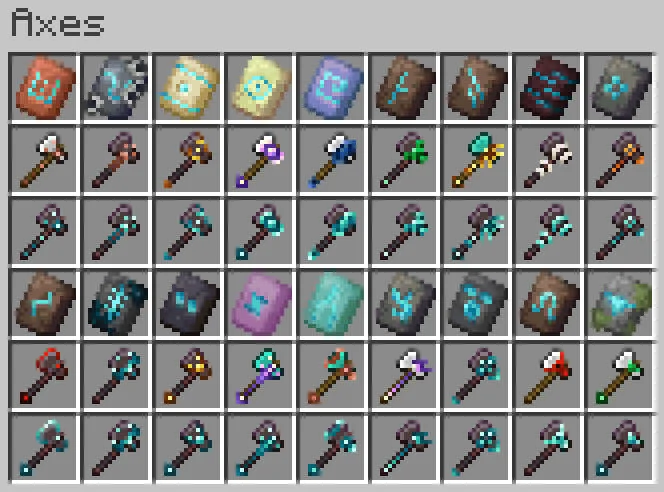
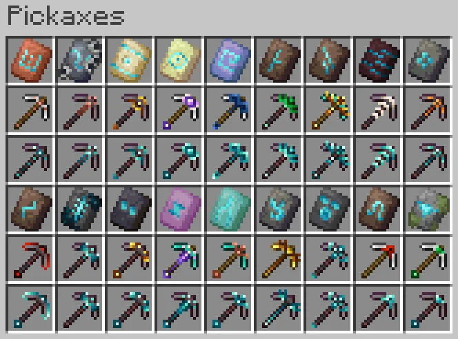
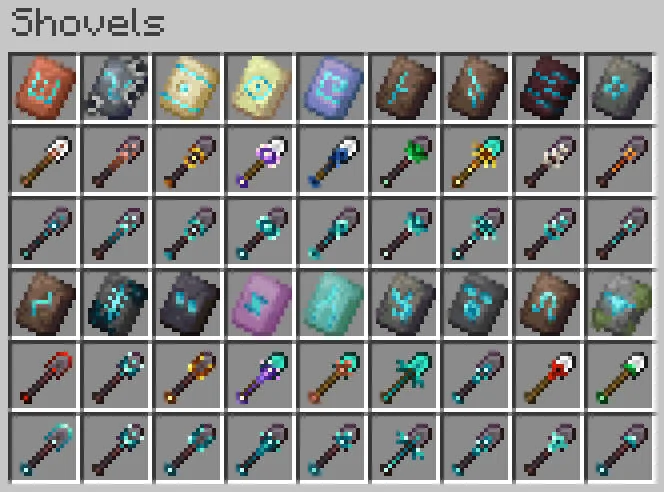
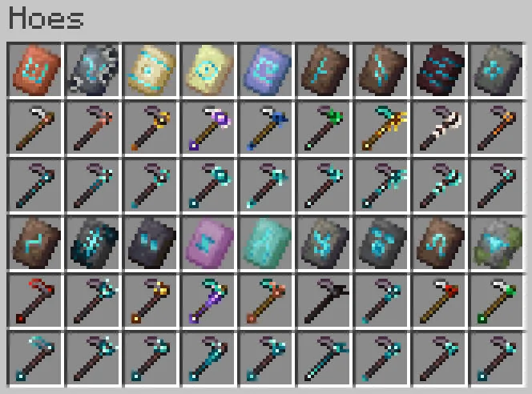
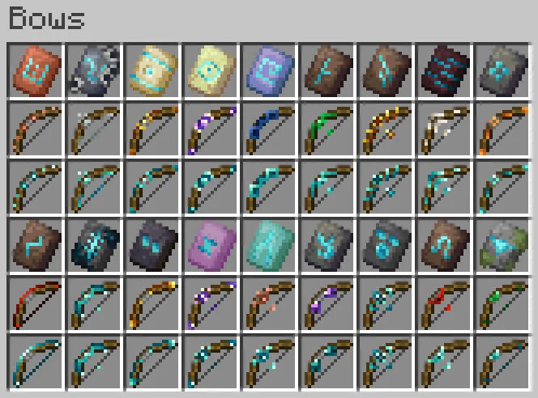
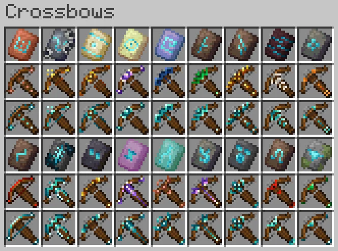

# 🎨 Шаблоны для инструментов <Badge type="warning" text="новое" />
Помимо отделок на броню, на сервер была добавлена возможность применять отделки на инструменты и оружия. Чтобы их увидеть, нужно установить наш ресурспак при входе на сервер. Отличие от прошлых сезонов в том, что больше нет отдельных шаблонов на предметы: применить можно любой имеющийся в игре.

::: details Мечи

:::

::: details Топоры

:::

::: details Кирки

:::

::: details Лопаты

:::

::: details Мотыги

:::

::: details Луки

:::

::: details Арбалеты

:::

##
# Золочёные шаблоны
Если один из элементов брони имеет золотое украшение, то на вас никак не будут реагировать пиглины.