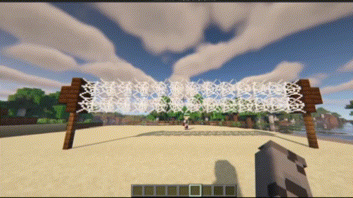

# 🏐 Волейбол

## Создание мяча
Чтобы создать свой волейбольный мяч, вам нужно держать в руке **8 кожи** и кликнуть ПКМ по живой **рыбе фугу**.
## Скины на мяч
Командой `/ballskin` можно поменять скин мяча. 