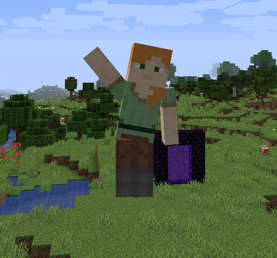

# 🕺 Эмоции и танцы
На сервере установлен плагин, благодаря которому работает EmoteCraft.

С помощью этого мода можно использовать различные эмоции и танцы, которые увидят другие игроки у которых установлен этот мод. Для того, чтобы его использовать мод, вам нужно нажать на кнопку `B` на латинской раскладке.

Скачать мод Emotecraft можно [тут](https://modrinth.com/plugin/noemotecraft/versions).

