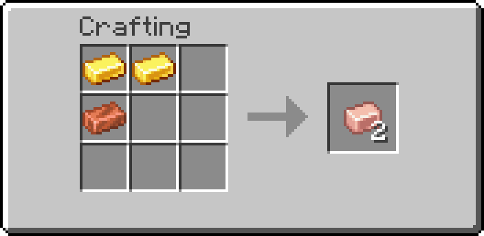

# 🎨 Больше кастомизации брони <Badge type="info" text="2 сезон" />
Помимо основных материалов отделки брони, были добавлены новые для цветного разнообразия.

## Крафт сплава розового золота
Сплав розового золота - новый материал, который крафтится из двух золотых и одного медного слитков и даёт броне нежный розовый цвет.

