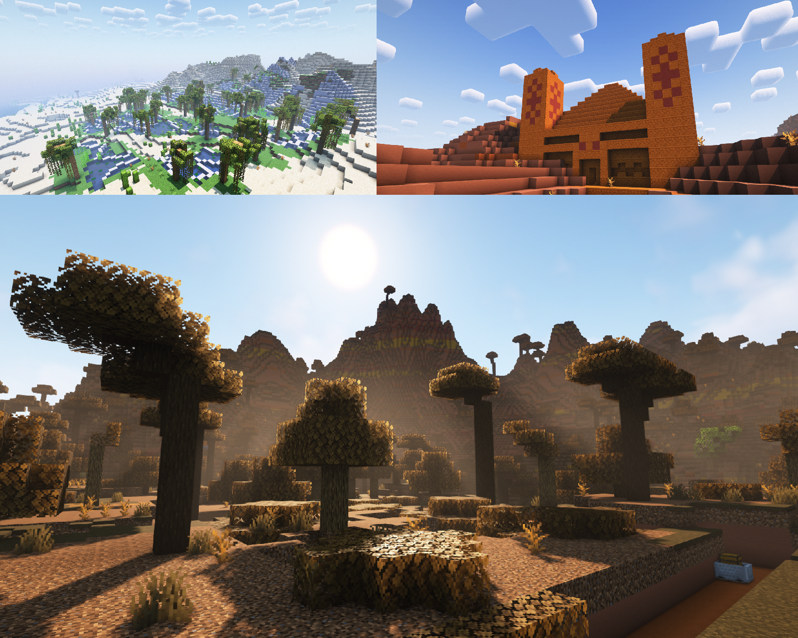

# 🏜 Пустыни и мессы <Badge type="info" text="2 сезон" />
Биомы "Пустыня" и "Выветренные земли" изменены, теперь они выглядят лучше, а их данжи стали сложнее и интереснее.

- **Пустынные пирамиды** потерпели большие изменения. Чтобы получить добычу внутри, вы должны исследовать пирамиду, найти все три части каркаса, а затем собрать их, чтобы войти в подвал, где сундуки охраняются привязками и големом.
- **Пирамида мессы**: вариант новых пирамид пустыни, более крупный, более сложный и наполненный огнем. Добыча внутри лучше, чем в Пустынной пирамиде, но добывать ее значительно опаснее.
- **Песчаные пауки**: новый вариант пауков, обитающий в пустынях и бесплодных землях. Они могут быстро закапываться в песок и иметь больше здоровья, но когда они не копают, они движутся немного медленнее, а если блоки не из песка, они будут двигаться еще медленнее.

..и многое другое, о чем вы узнаете, начав исследовать мир.

