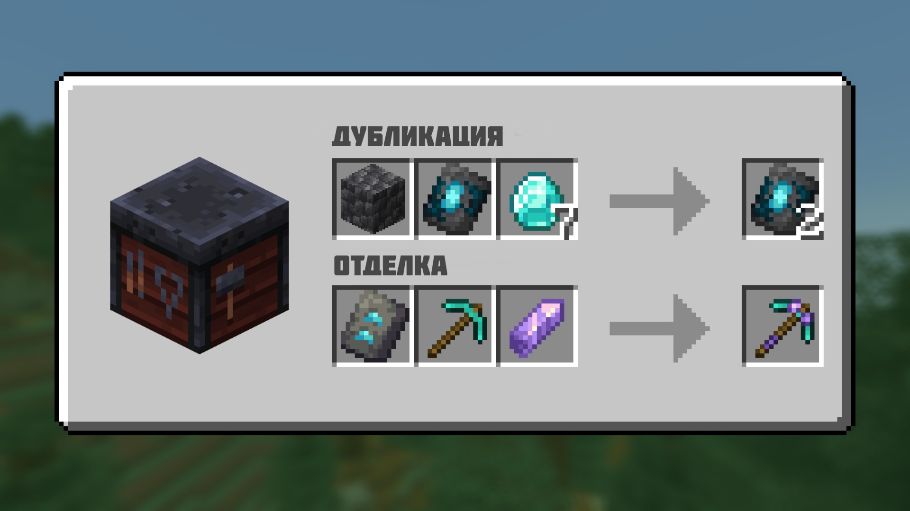
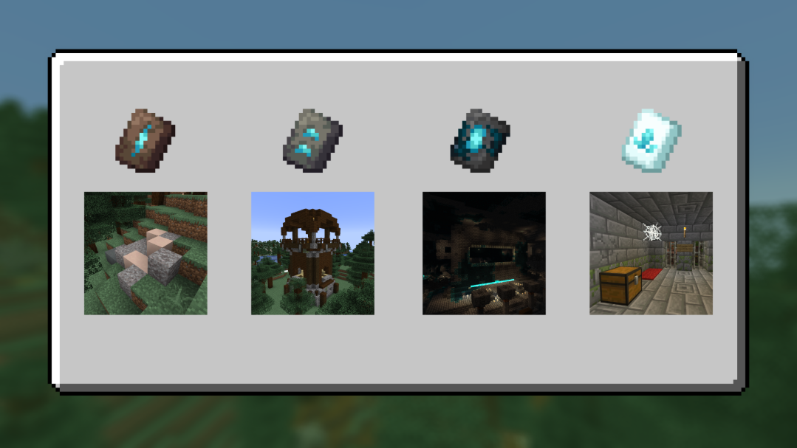

# 🎨 Шаблоны для инструментов <Badge type="info" text="3 сезон" />
Помимо отделок на броню, на сервер были добавлены отделки на инструменты и оружия. Чтобы их увидеть, нужно установить наш ресурспак при входе на сервер.

## Новые шаблоны
Шаблоны на инструменты встречаются в следующих структурах:
- Шаблон «Линии» в **руинах троп**;
- Шаблон «Следы» в **аванпосте разбойников**;
- Шаблон «Заряд» в **затерянном городе**;
- Шаблон «Мороз» в **иглу**.

